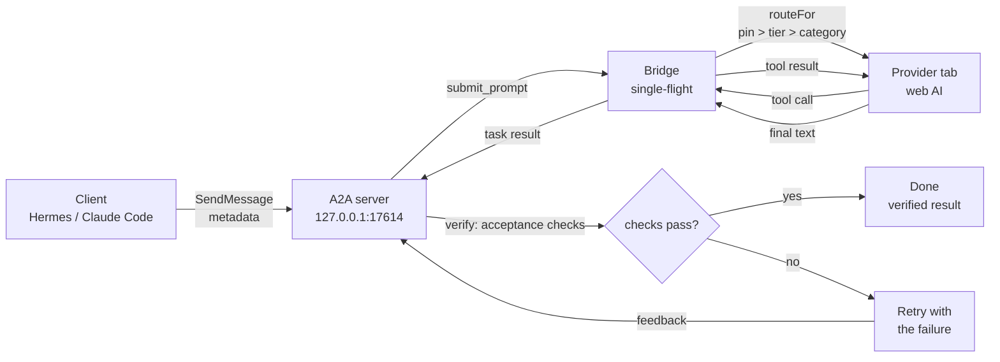

# A2A task flow

One delegation: a caller hands a task to a web AI through the bridge, the harness
verifies the result, and a failure comes back as feedback instead of as a silent
"done".

## Image (works everywhere, including GitHub comments)



PNG for places that do not render SVG: [`../assets/a2a-task-flow.png`](../assets/a2a-task-flow.png)

## Mermaid (renders in issues, PR bodies and most Markdown viewers)

Source: [`a2a-task.mmd`](a2a-task.mmd)



GitHub does **not** render Mermaid inside comments (and not in every issue/PR
view), so paste the image there and keep Mermaid for the body of a PR where it
does render.

## ASCII (works in a terminal, a commit message, or a chat)

Source: [`a2a-task.txt`](a2a-task.txt)

```
 Client (Hermes / Claude Code)
        |  SendMessage + metadata
        v
 A2A server 127.0.0.1:17614
        |  submit_prompt (single flight)
        v
 Bridge -> routeFor (provider > modelTier > taskCategory > complexity)
        v
 Provider tab (web AI)  <-- tool call / tool result -->  Bridge
        |  final text
        v
 Bridge -> A2A server -> harness: acceptance checks
        |                                   |
        |                          pass ----+--> done (verified)
        |                          fail ----+--> retry with feedback
```

## Regenerate

```bash
npx --yes @mermaid-js/mermaid-cli@11 -i docs/flows/a2a-task.mmd \
  -o docs/assets/a2a-task-flow.svg -b white -w 1600
npx --yes @mermaid-js/mermaid-cli@11 -i docs/flows/a2a-task.mmd \
  -o docs/assets/a2a-task-flow.png -b white -w 1600 -s 2
```

An Excalidraw export is fine too, and is the better choice when the diagram needs
hand layout: keep the same node names so prose and picture stay in sync.
